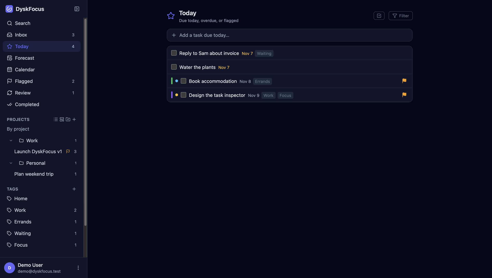
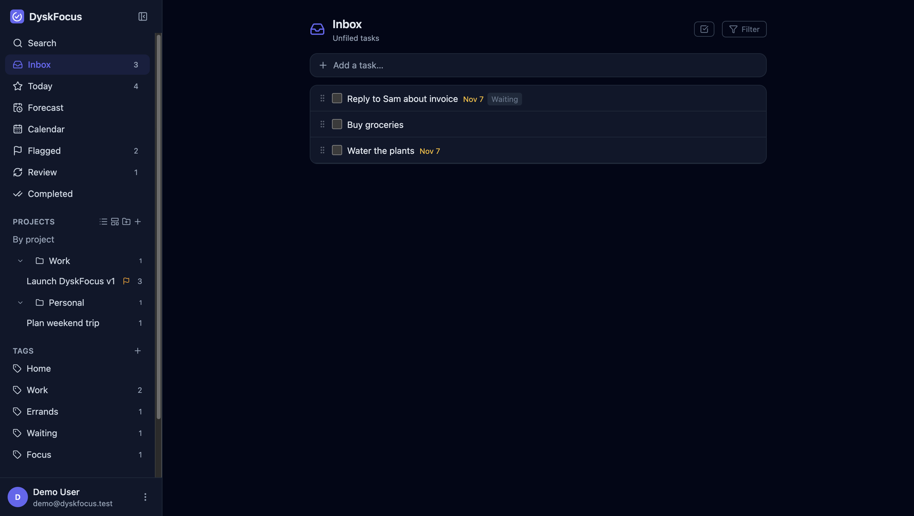
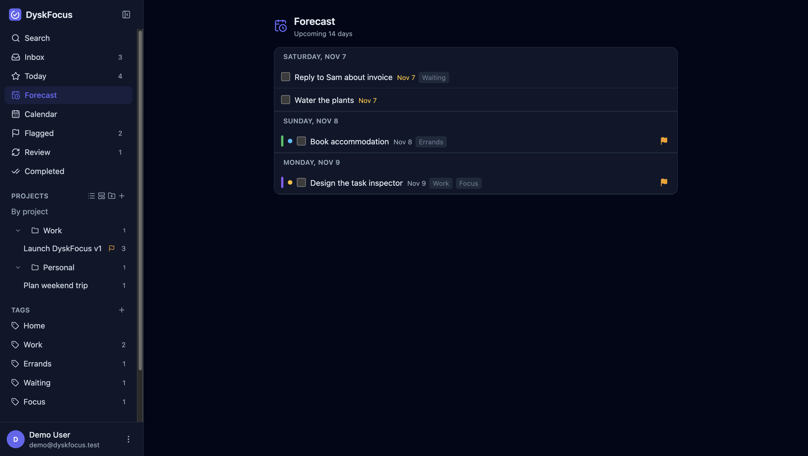
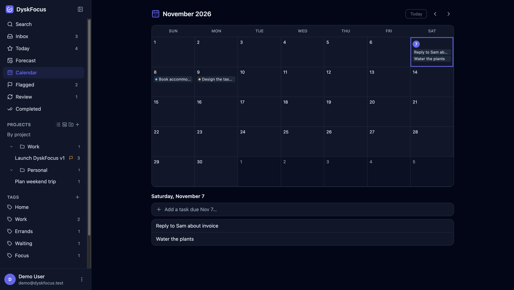

<p align="center">
  
</p>

<h1 align="center">DyskFocus</h1>

<p align="center">A focused, OmniFocus-style task manager that you host yourself, use offline, or run as a macOS app.</p>

<p align="center">
  <a href="https://github.com/DyskLab/dyskfocus/releases/latest"></a>
  <a href="LICENSE"></a>
  <a href="https://www.fanny.dev/dysklab"></a>
  <a href="https://buymeacoffee.com/fannydevz"></a>
</p>



## Get it

**macOS (Apple Silicon):** download the DMG from the
[latest release](https://github.com/DyskLab/dyskfocus/releases/latest) and drag **DyskFocus** into Applications. It
bundles PHP and SQLite, so there's no server to set up. On Intel, [build it yourself](desktop.md).

The app isn't notarized, so macOS blocks the first launch. Open **System Settings > Privacy & Security** and choose
**Open Anyway**, or run:

```bash
xattr -dr com.apple.quarantine /Applications/DyskFocus.app
```

If you used Stackr before, your data is copied over the first time you open DyskFocus, and the old copy stays where it
was.

**Self-hosted:** see [Quick start](#quick-start).

## Features

- **Inbox, Projects, and Tasks** with nested subtasks and drag-and-drop reordering
- **Tags** with colors, **Perspectives** that save a custom filter, and a **Review** mode
- **Defer and due dates**, flags, priorities, task colors, and recurring tasks
- **Today, Forecast, Calendar, Flagged, and Completed** views
- **Markdown** notes and comments
- **Natural-language quick add**, such as `Pay rent !high #home tomorrow`
- **Bulk actions**, swipe gestures, and a mobile bottom sheet
- **Dark mode**, keyboard shortcuts, and timezone-aware dates
- **Real-time sync** across tabs and **web push** reminders on the self-hosted version
- **JSON backup and restore**, with a first-run setup wizard

| Inbox | Forecast | Calendar |
| --- | --- | --- |
|  |  |  |

## Quick start

```bash
git clone https://github.com/DyskLab/dyskfocus.git
cd dyskfocus
cp .env.example .env
composer install
npm install
npm run build
php artisan key:generate
```

Then open the app. A setup wizard creates the database and your account, and can import a backup. See
[setup.md](setup.md) for the full steps, including [DDEV](https://ddev.com).

To build the macOS app, see [desktop.md](desktop.md).

## Tech

Laravel, React 19, TypeScript, Vite, TanStack Query, Zustand, dnd-kit, Tailwind, SQLite, Sanctum, and Electron with
static PHP.

## Support

DyskFocus is free and open source. If it helps you, you can
[buy me a coffee](https://buymeacoffee.com/fannydevz).

## Part of DyskLab

DyskFocus is part of [DyskLab](https://www.fanny.dev/dysklab), alongside
[DyskFlow](https://github.com/DyskLab/dyskflow), [DyskFiles](https://github.com/DyskLab/dyskfiles), and DyskLink for
[Mac](https://github.com/DyskLab/dysklink-mac) and [Android](https://github.com/DyskLab/dysklink-android).

## License

[MIT](LICENSE)
